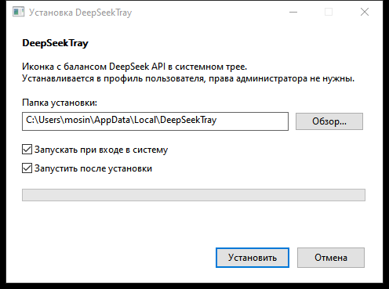

# DeepSeekTray

Баланс DeepSeek API в системном трее Windows: цифра прямо на иконке, подробности — в тултипе.


## Установка

Один файл — `dist\DeepSeekTraySetup.exe` (25 МБ), права администратора не нужны:

1. Запустить `DeepSeekTraySetup.exe`.
2. При необходимости изменить папку (по умолчанию `%LOCALAPPDATA%\DeepSeekTray`), снять галочки автозапуска/запуска.
3. «Установить».



Что делает установщик:

- распаковывает приложение и Qt-библиотеки;
- создаёт ярлык в меню «Пуск» и (по галочке) в автозапуске;
- добавляет запись в «Программы и компоненты»;
- останавливает запущенный экземпляр перед обновлением;
- запускает приложение.

Удаление: «Параметры → Приложения → DeepSeekTray», либо `%LOCALAPPDATA%\DeepSeekTray\Uninstall.exe`. Логи и настройки остаются в `%APPDATA%\DeepSeekTray`.

Если папка по умолчанию недоступна (например, установщик запущен из ограниченной среды), установщик покажет код ошибки и попробует `%LOCALAPPDATA%\Programs\DeepSeekTray`, `%APPDATA%\DeepSeekTray`, `C:\Users\Public\Documents\DeepSeekTray`; папку можно выбрать и вручную. Подробности пишутся в `%TEMP%\DeepSeekTraySetup.log`.

### Тихая установка

```bat
DeepSeekTraySetup.exe /S /dir="D:\Tools\DeepSeekTray" /log="%TEMP%\ds-setup.log"
Uninstall.exe /S
```

Ключи: `/S` — без окон, `/dir=<путь>`, `/startup=<папка>`, `/log=<файл>`, `/ns` — без ярлыков, `/nr` — без записи в реестре, `/nl` — не запускать, `/noautostart`, `/nolaunch`.

## Что делает приложение

- Опрашивает `GET https://api.deepseek.com/user/balance` раз в 5 минут (после ошибки — повтор через минуту).
- Рисует на иконке остаток в основной валюте (`44`, `2.2`, `1.5k`); красная «таблетка» — если API недоступен или баланс исчерпан.
- Тултип: суммы по всем валютам и время последнего обновления.
- Меню по правому клику: **Обновить**, **Открыть platform.deepseek.com**, **Выход**. Левый клик — обновить немедленно.
- Лог и кэш последнего ответа: `%APPDATA%\DeepSeekTray\` (`tray.log`, `last-balance.json`).
- Один экземпляр на сеанс, поддержка высокого DPI.

## Ключ API

Ищется по порядку:

1. переменная окружения `DEEPSEEK_API_KEY`;
2. `%APPDATA%\DeepSeekTray\config.ini`:
   ```ini
   [api]
   key=sk-...
   ```
3. профиль DSH: `~/.dsh/.credentials.yaml`, строка `DEEPSEEK_API_KEY: sk-...`.

## Проверка без трея

```powershell
dist\DeepSeekTray.exe --check
dist\DeepSeekTray.exe --check --url http://127.0.0.1:8765/user/balance   # локальный mock
dist\DeepSeekTray.exe --render .\icons                                  # PNG иконок 16/24/32/64
powershell -ExecutionPolicy Bypass -File tests\run-tests.ps1            # mock 200/401/500
```

Коды возврата `--check`: `0` — успех, `4` — 401 (ключ не принят), `1` — прочие ошибки.

## Сборка

Требуется: Windows 10/11 x64, Qt 5.15.2 (msvc2022) в `C:\Qt\5.15.2\msvc2022`, Visual Studio 2022, Python 3.

```powershell
powershell -ExecutionPolicy Bypass -File scripts\build-and-deploy.ps1
```

Скрипт собирает приложение через `qmake`/`nmake` (`build-qmake.bat`), раскладывает Qt-зависимости `windeployqt` в `dist`, затем вызывает `installer\build-installer.bat`, который собирает `Uninstall.exe` и `DeepSeekTraySetup.exe` с встроенным payload.

Только установщик (если `dist` уже готов): `installer\build-installer.bat`.

## Устройство

- `src/main.cpp` — трей-приложение: `httpGet()` (синхронный WinHTTP), разбор JSON, `renderIcon()` (`QPainter`), `TrayApp` (`QSystemTrayIcon`, меню, `QTimer`, запрос в `QThreadPool` с возвратом в GUI-поток).
- `installer/installer.cpp` — установщик на Win32: GUI, распаковка ресурсов, ярлыки (`IShellLink`), ключ удаления.
- `installer/uninstall.cpp` — удаление: остановка приложения, ярлыки, реестр, очистка папки через `cmd` после выхода.
- `installer/gen_payload.py` — генерирует `payload.rc` и `payload_index.h` из `dist`.

Почему WinHTTP, а не `QNetworkAccessManager`: установленный Qt 5.15.2 собран без OpenSSL (`QSslSocket` отсутствует, схема `https` не поддерживается), поэтому HTTPS в нём недоступен. WinHTTP не требует дополнительных DLL.

## Известные ограничения

- Windows 10 по умолчанию прячет новые значки в «переполнение» (`^`): Параметры → Персонализация → Панель задач → «Выберите, какие значки отображать» → включить DeepSeekTray.
- В среде DSH (ограниченный токен) недоступны Windows TLS и запись в `HKCU`/`%APPDATA%`, поэтому реальный запрос к API и запись в реестр проверялись вне её: приложение — на локальном mock, установщик — с ключами `/nr` и `/dir`.
- Прокси: системная настройка (AUTOMATIC_PROXY с откатом на DEFAULT_PROXY), таймауты 5/5/10/15 с.

## Что дальше

- выбор валюты (CNY/USD) и формата цифры;
- уведомление при падении баланса ниже порога;
- окно настроек (интервал, порог, ключ) вместо INI;
- иконка для exe/ярлыка и подпись установщика.
