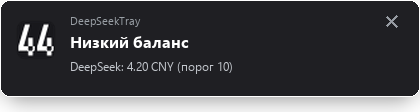

<div align="center">
  
</div>

<h1 align="center">DeepSeekTray</h1>

<p align="center">
  Баланс DeepSeek API в системном трее Windows —<br>
  цифра на иконке и крупная плашка рядом с часами.
</p>

<p align="center">
  
  
  
  
</p>

---

## Зачем это нужно

Баланс DeepSeek API виден только в личном кабинете: чтобы проверить остаток, нужно открыть сайт, войти и найти нужную страницу. Когда деньги заканчиваются, запросы начинают падать с ошибкой — и это замечаешь уже по сломанному коду, а не по счёту.

DeepSeekTray держит остаток на виду: цифра в трее и крупная плашка рядом с часами. Один взгляд — и понятно, хватит ли баланса на сегодняшнюю работу.

## Возможности

- **Иконка в трее.** Остаток цифрами (`44`, `2.2`, `1.5k`), красная — если API недоступен или баланс исчерпан.
- **Виджет у часов.** Плашка с цифрами 24 px: перетаскивается, позиция запоминается, включается галочкой в меню.
- **Несколько источников.** Провайдеры описываются секциями `[providers.*]`; активный выбирается в настройках.
- **Уведомление о низком балансе.** Когда остаток опускается ниже порога — всплывает сообщение в трее.
- **Настройки на ходу.** Частота опроса, порог, валюта и активный API — в `config.ini`, перечитывается без перезапуска.
- **Детали в тултипе.** Суммы по валютам всех включённых провайдеров и время обновления.

<p align="center">
  
  &nbsp;&nbsp;
  
</p>

## Установка

Скачайте последнюю сборку со страницы [Releases](https://github.com/immosin/deepseek-tray/releases/latest):

| Файл | Что это |
| --- | --- |
| `DeepSeekTraySetup.exe` | установщик, права администратора не нужны |
| `DeepSeekTray-portable.zip` | портативная сборка: распаковать и запустить `DeepSeekTray.exe` |


Удаление — «Параметры → Приложения» или `Uninstall.exe` в папке установки.

## Использование

Правый клик по иконке — меню:

- **Обновить** — запросить баланс сейчас;
- **Открыть настройки** — `%APPDATA%\DeepSeekTray\config.ini` в блокноте;
- **Виджет у часов** — плашка с крупными цифрами;
- **Личный кабинет** — расход и пополнение у активного провайдера;
- **Выход**.

## Настройки

Файл `%APPDATA%\DeepSeekTray\config.ini` открывается из меню и перечитывается перед каждым обновлением — перезапуск не нужен.

```ini
[settings]
refresh_minutes=5          ; период опроса, минуты (1–1440)
low_balance_threshold=10   ; общий порог уведомления (0 — выключить)
currency=auto              ; auto, CNY или USD
provider=deepseek          ; id активного источника

[providers.deepseek]
type=deepseek
title=DeepSeek
url=https://api.deepseek.com/user/balance
console=https://platform.deepseek.com/usage
key=                       ; пусто — ключ возьмётся из DEEPSEEK_API_KEY или профиля DSH
enabled=true

; свои пороги по валютам — для каждого провайдера отдельная секция
[thresholds.deepseek]
CNY=10
USD=1
```

Провайдеров может быть несколько: добавьте ещё одну секцию `[providers.<id>]` и укажите её id в `provider=`. Сейчас поддержан тип `deepseek`; Kimi — в планах.

Порог уведомления ищется по цепочке: ключ валюты в `[thresholds.<id>]` → `default=` в той же секции → общий `low_balance_threshold`. Если у провайдера заданы только отдельные валюты, остальные не контролируются; `0` отключает уведомления для этой валюты.

## Сборка

Нужны Windows 10/11 x64, Qt 5.15.2 (msvc2022), Visual Studio 2022 и Python 3.

```powershell
git clone https://github.com/immosin/deepseek-tray.git
cd deepseek-tray
powershell -ExecutionPolicy Bypass -File scripts\build-and-deploy.ps1
```

| Скрипт | Что делает |
| --- | --- |
| `build-qmake.bat` | `qmake` + `nmake`, релизная сборка приложения |
| `scripts\build-and-deploy.ps1` | всё сразу: приложение, `windeployqt`, установщик и zip |
| `installer\build-installer.bat` | только `Uninstall.exe` и `DeepSeekTraySetup.exe` |
| `tests\run-tests.ps1` | проверки запросов и разбора JSON на локальном mock |

Проверка без трея: `DeepSeekTray.exe --check`, выбор источника: `--check --provider <id>`, отрисовка: `--render <папка>`.

## Структура

```text
src/main.cpp        приложение: трей, виджет, отрисовка иконки
src/provider.*      провайдеры баланса и разбор ответов API
src/settings.*      config.ini: параметры и список источников
src/http.*          WinHTTP-транспорт
src/appdirs.*       пути данных и лог
installer/          установщик и деинсталлятор на Win32
scripts/            сборка и упаковка
tests/              mock API и проверки
docs/               изображения для README
```

## Планы

- [ ] Показывать доллары и юани одновременно — в иконке, виджете и тултипе.
- [ ] Интеграция Kimi (Moonshot API) как второго источника баланса.
- [ ] Другие провайдеры (OpenAI, Anthropic и т. п.) в том же интерфейсе.

## Лицензия

MIT — см. [LICENSE](LICENSE).
