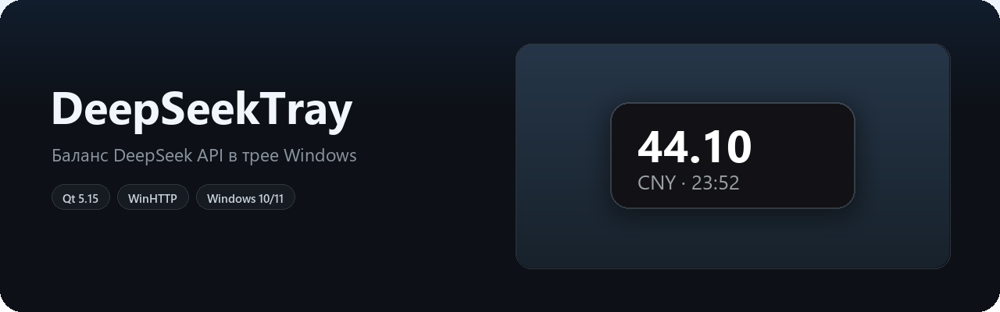
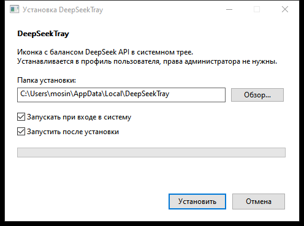

<div align="center">
  
</div>

<h1 align="center">DeepSeekTray</h1>

<p align="center">
  Баланс DeepSeek API в системном трее Windows —<br>
  цифра на иконке и крупная плашка рядом с часами.
</p>

<p align="center">
  
  
  
  
</p>

---

## Зачем это нужно

Баланс DeepSeek API виден только в личном кабинете: чтобы проверить остаток, нужно открыть сайт, войти и найти нужную страницу. Когда деньги заканчиваются, запросы начинают падать с ошибкой — и это замечаешь уже по сломанному коду, а не по счёту.

DeepSeekTray держит остаток на виду: цифра в трее и крупная плашка рядом с часами. Один взгляд — и понятно, хватит ли баланса на сегодняшнюю работу.

## Возможности

- **Иконка в трее.** Остаток цифрами (`44`, `2.2`, `1.5k`), красная — если API недоступен или баланс исчерпан.
- **Виджет у часов.** Плашка с цифрами 24 px: перетаскивается, позиция запоминается, включается галочкой в меню.
- **Детали в тултипе.** Суммы по валютам, время последнего обновления.
- **Опрос раз в 5 минут**, после ошибки — повтор через минуту; последний ответ кэшируется.
- Один экземпляр на сеанс, поддержка высокого DPI, никаких зависимостей во время работы.


## Установка

Скачайте последнюю сборку со страницы [Releases](https://github.com/immosin/deepseek-tray/releases/latest):

| Файл | Что это |
| --- | --- |
| `DeepSeekTraySetup.exe` | установщик, права администратора не нужны |
| `DeepSeekTray-portable.zip` | портативная сборка: распаковать и запустить `DeepSeekTray.exe` |



Удаление — «Параметры → Приложения» или `Uninstall.exe` в папке установки.

## Использование

После запуска в трее появляется иконка с балансом. Правый клик — меню:

- **Обновить** — запросить баланс сейчас;
- **Виджет у часов** — плашка с крупными цифрами;
- **Открыть platform.deepseek.com** — расход и пополнение;
- **Выход**.

Ключ API берётся по порядку: переменная `DEEPSEEK_API_KEY` → `%APPDATA%\DeepSeekTray\config.ini` → профиль DSH (`~/.dsh/.credentials.yaml`).

```ini
[api]
key=sk-...
```

## Сборка

Нужны Windows 10/11 x64, Qt 5.15.2 (msvc2022), Visual Studio 2022 и Python 3.

```powershell
git clone https://github.com/immosin/deepseek-tray.git
cd deepseek-tray
powershell -ExecutionPolicy Bypass -File scripts\build-and-deploy.ps1
```

| Скрипт | Что делает |
| --- | --- |
| `build-qmake.bat` | `qmake` + `nmake`, релизная сборка приложения |
| `scripts\build-and-deploy.ps1` | всё сразу: приложение, `windeployqt`, установщик и zip |
| `installer\build-installer.bat` | только `Uninstall.exe` и `DeepSeekTraySetup.exe` |
| `tests\run-tests.ps1` | проверки запросов и разбора JSON на локальном mock |

Проверка без трея: `DeepSeekTray.exe --check`, отрисовка иконок: `--render <папка>`.

## Структура

```text
src/main.cpp        приложение: трей, виджет, отрисовка иконки, HTTP
installer/          установщик и деинсталлятор на Win32
scripts/            сборка и упаковка
tests/              mock API и проверки
docs/               изображения для README
```

## Планы

- [ ] Показывать доллары и юани одновременно — в иконке, виджете и тултипе.
- [ ] Уведомление, когда баланс опускается ниже заданного порога.
- [ ] Работа с API других провайдеров (OpenAI, Anthropic и т. п.) в том же интерфейсе.

## Лицензия

MIT — см. [LICENSE](LICENSE).
